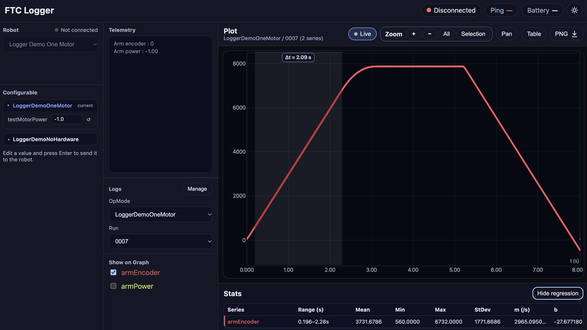

# FTC Logger

FTC Logger allows you to write logs from within an OpMode to JSONL files on the Robot Controller and provides a built-in web UI to explore plots, statistics, and run data.



## What it does
- Writes run logs as JSONL files under:
  `.../ftc-logger/<OpMode>/<RunNumber>.jsonl`
- Exposes a lightweight HTTP API on the RC web server at `/logger/api/*`
- Serves a web UI at `/logger` for plotting and inspecting runs
- Lets you view and edit `public static` variables of `@Configurable` classes live from the web UI

## How to add to your Robot Controller
1) Download and extract the ZIP file of this repository.
2) Add the full `logger` folder to your teamcode folder (dev-tools and demoOpModes are optional and can be deleted).
3) Follow the instructions below to use it in an OpMode

## How to use in an OpMode
1) Create a `LogWriter` object.
2) Use ElapsedTime() to track time (use seconds, milliseconds, or nanoseconds).
3) Write log lines once per loop with a simple call: `logger.logMilliseconds(t, "armEncoder", pos, "armPower", armPower);`

### Example OpMode
This assumes you have a motor and encoder plugged into your Robot Controller and named `armMotor` in your configuration.

```java
import com.qualcomm.robotcore.eventloop.opmode.LinearOpMode;
import com.qualcomm.robotcore.eventloop.opmode.TeleOp;
import com.qualcomm.robotcore.hardware.DcMotor;
import com.qualcomm.robotcore.util.ElapsedTime;

import org.firstinspires.ftc.teamcode.logger.LogWriter;


@TeleOp(name = "Sample Logger Op Mode", group = "Logger")
public class SampleLoggerOpMode extends LinearOpMode {
    private ElapsedTime runtime = new ElapsedTime();
    private LogWriter logger = null;
    private DcMotor armMotor = null;
    private double armPower = 1.0;
    
    @Override
    public void runOpMode() throws InterruptedException {
        armMotor = hardwareMap.get(DcMotor.class, "armMotor");
        logger = new LogWriter(hardwareMap.appContext, getClass().getSimpleName());
        
        // Optional check to make sure file can be written 
        if (!logger.isReady()) {
            telemetry.addLine("Logger failed to start.");
            telemetry.addData("Error", logger.getInitError());
            telemetry.update();
            return;
        }

        waitForStart();
        runtime.reset(); // start the opMode timer at 0

        while (opModeIsActive()) {
            
            armMotor.setPower(armPower);
            armPower -= 0.01;
            
            int pos = armMotor.getCurrentPosition();

            //get the current time in milliseconds
            double t = runtime.milliseconds(); 

            // Write one line to the log file.
            // The first argument is the current time
            // The rest of the arguments are key, value pairs
            logger.logMilliseconds(t, "armEncoder", pos, "armPower", armPower);

        }
    }
}
```

## Configurable variables
Mark any class in TeamCode with `@Configurable` and its `public static` (non-final) fields show up in the **Configurable** panel under the Series list. Values can be edited from the browser while the robot is running.

```java
import org.firstinspires.ftc.teamcode.logger.java.Configurable;

@Configurable
@TeleOp(name = "Arm Tuner")
public class ArmTuner extends LinearOpMode {
    public static double kP = 0.01;
    public static int targetPosition = 500;
    public static boolean useFeedforward = true;
    // ...
}
```

- The class that matches the currently selected OpMode (by class name, the same name used for its log folder) is listed first and expanded; other classes are collapsed. Nested classes (e.g. `ArmTuner.Params`) are grouped with their outer OpMode.
- Supported types: `int`, `long`, `short`, `byte`, `double`, `float`, `boolean` (and boxed versions), `String`, and enums. `final` fields and other types are not shown.
- Type a value and press Enter (or click away) to send it. A green border means it was applied; red means it was rejected (hover for the reason). Esc reverts.
- Changes take effect the next time your code reads the field, so read the field inside your loop for live tuning. Values are not saved: they reset to the defaults in your code when the Robot Controller app restarts.
- Click ↻ to reload the current values from the robot.
- Classes are found by scanning the installed TeamCode APK, so this works for code built with Android Studio (not OnBot Java).

## Viewing logs
- Connect to the Robot Controller WiFi, then open a browser to `http://192.168.43.1:8080/logger`
- The UI allows you to select an OpMode and choose from multiple runs.
- The File Manager allows you to rename or delete log files.

## API summary
- `GET /logger/api/opmodes`
- `GET /logger/api/runs?opMode=NAME`
- `GET /logger/api/run?opMode=NAME&run=RUN`
- `GET /logger/api/data?opMode=NAME&run=RUN`
- `GET /logger/api/fs`
- `GET /logger/api/rename?opMode=NAME&run=RUN&base=BASE&suffix=SUFFIX`
- `GET /logger/api/delete?opMode=NAME&run=RUN`
- `GET /logger/api/config`
- `GET /logger/api/setconfig?class=FULL_CLASS_NAME&field=FIELD&value=VALUE`

## Dev tools
The `dev-tools` folder contains a lightweight local server and a fake log file so you can iterate on the UI without deploying to a Robot Controller.

- Location: `TeamCode/src/main/java/org/firstinspires/ftc/teamcode/logger/dev-tools`
- UI assets: `TeamCode/src/main/java/org/firstinspires/ftc/teamcode/logger/web`
- `logger-dev-server.py`: serves the local UI and can proxy the API or serve fake data
- `fake-log.jsonl`: sample log file used by the dev server

### Run with fake data
```bash
python3 TeamCode/src/main/java/org/firstinspires/ftc/teamcode/logger/dev-tools/logger-dev-server.py --fake
```
Then open `http://127.0.0.1:8000/`.

### Run while connected to the Robot Controller WiFi
```bash
python3 TeamCode/src/main/java/org/firstinspires/ftc/teamcode/logger/dev-tools/logger-dev-server.py --robot
```
Then open `http://127.0.0.1:8000/`.

## License
MIT License. See the repository `LICENSE` file for details.
